# LSP Gateway 架构与执行流程详解

## 概述

LSP Gateway 是一个高性能的 LLM 请求路由网关，实现了基于健康度和延迟的智能切量机制。本文档详细说明了系统的架构设计、执行流程，以及核心的切量算法。

## 系统架构

```mermaid
graph TD
    %% Client Request Flow
    Client[Client Request] --> Router[Axum Router]
    Router --> ChatHandler["/v1/chat/completions<br/>Handler"]

    %% Provider Selection Pipeline
    ChatHandler --> ProviderService[ProviderService<br/>select_provider]
    ProviderService --> ModelCache{Model Config<br/>Cache Hit?}
    ModelCache -->|Hit| CachedConfig[Use Cached Config]
    ModelCache -->|Miss| DBQuery[Query PostgreSQL<br/>ModelConfig]
    DBQuery --> CacheStore[Store in Cache]
    CacheStore --> CachedConfig

    CachedConfig --> GroupCheck{Has Provider<br/>Group?}
    GroupCheck -->|No| DirectProvider[Use Direct Provider<br/>baseUrl + provider]
    GroupCheck -->|Yes| QueryProviders[Query ModelProvider<br/>by group + active=true]

    %% Provider Pipeline (切量核心逻辑)
    QueryProviders --> Pipeline[ProviderPipeline<br/>select_provider]
    Pipeline --> PreProcess[Preprocessing:<br/>Rate Limit Filter]
    PreProcess --> Step1[Step 1: Circuit Breaker<br/>Filter by Redis circuit_state]
    Step1 --> Step2[Step 2: Health Weight Apply<br/>dynamic_weight from Redis]
    Step2 --> Step3[Step 3: Price Tier Filter<br/>Select lowest price tier]
    Step3 --> Step4[Step 4: Weighted Random<br/>Final selection]

    %% HTTP Client & Response
    Step4 --> SelectedProvider[Selected Provider]
    DirectProvider --> SelectedProvider
    SelectedProvider --> LlmClient[LlmClient with<br/>timeout config]
    LlmClient --> StreamCheck{stream: true?}

    StreamCheck -->|Yes| StreamRequest[chat_completions_stream<br/>with dual timeout]
    StreamCheck -->|No| RegularRequest[chat_completions<br/>with timeout]

    StreamRequest --> StreamResponse[text/plain response<br/>concatenated chunks]
    RegularRequest --> JsonResponse[JSON ChatCompletionResponse]

    %% Metrics Recording
    StreamResponse --> RecordMetrics[Record Success/Failure<br/>Latency, Tokens]
    JsonResponse --> RecordMetrics
    RecordMetrics --> MetricsReporter[MetricsReporter<br/>local window aggregation]
    RecordMetrics --> HealthMonitor[HealthMonitor<br/>local health tracking]
    RecordMetrics --> PrometheusMetrics[PrometheusMetrics<br/>direct recording]

    %% Background Tasks & Supervisor
    subgraph "Background Tasks (每个Gateway实例)"
        MetricsTask[MetricsReporter Task<br/>每3秒上报到Redis]
        HealthTask[HealthMonitor Task<br/>周期写入Redis健康哈希]
        GatewayManager[GatewayManager<br/>实例注册+心跳]
        SupervisorManager[SupervisorManager<br/>分布式锁管理]
    end

    MetricsReporter --> MetricsTask
    HealthMonitor --> HealthTask

    %% Supervisor (分布式监督器)
    subgraph "Supervisor (单实例运行)"
        SupervisorLock[Redis分布式锁<br/>supervisor:lock]
        SupervisorMain[Supervisor主循环<br/>每3秒执行]

        %% Supervisor Pipeline
        MetricsAggregator[MetricsAggregator<br/>聚合所有Gateway指标]
        HealthCalculator[HealthCalculator<br/>计算健康评分]
        TrafficAdjuster[TrafficAdjuster<br/>基于延迟调整权重]
        CircuitBreaker[CircuitBreaker<br/>熔断器状态管理]

        SupervisorMain --> MetricsAggregator
        MetricsAggregator --> HealthCalculator
        HealthCalculator --> TrafficAdjuster
        TrafficAdjuster --> CircuitBreaker
        CircuitBreaker --> RedisStore[存储到Redis<br/>health_score, dynamic_weight<br/>circuit_state, availability]
    end

    SupervisorManager --> SupervisorLock
    SupervisorLock -->|获得锁| SupervisorMain

    %% Redis Data Flow
    subgraph "Redis数据存储"
        ProviderMetrics[provider_metrics:*<br/>各Gateway上报的指标]
        ProviderHealth[provider_health:*<br/>健康状态和动态权重]
        GatewayInstances[gateway_instances:*<br/>Gateway实例注册]
        RateLimitData[rate_limit:*<br/>滑动窗口限流数据]
    end

    MetricsTask --> ProviderMetrics
    HealthTask --> ProviderHealth
    GatewayManager --> GatewayInstances
    PreProcess --> RateLimitData
    RedisStore --> ProviderHealth

    %% Feedback Loop (切量反馈)
    ProviderHealth -.->|读取dynamic_weight| Step2
    ProviderHealth -.->|读取circuit_state| Step1
    ProviderMetrics -.->|聚合分析| MetricsAggregator

    style Pipeline fill:#e1f5fe
    style SupervisorMain fill:#f3e5f5
    style TrafficAdjuster fill:#fff3e0
```



## 核心组件说明

### 1. 请求处理流程

#### 1.1 请求入口

- **路由**: `POST /v1/chat/completions` → `handlers::chat::completions`
- **解析**: 解析 OpenAI 格式的 ChatCompletionRequest
- **日志**: 记录请求开始和模型 ID

#### 1.2 Provider 选择管道

```rust
// 核心选择逻辑
pub async fn select_provider(&self, model_id: &str) -> Result<SelectedProvider> {
    // 1. 获取模型配置（缓存优先）
    let model_config = self.get_model_config_by_id(model_id).await?;

    // 2. 检查是否有Provider组
    if let Some(group) = &model_config.model_provider_group {
        // 使用Provider组的智能路由
        self.get_provider_by_group(group).await
    } else {
        // 直接使用模型配置的Provider
        self.use_direct_provider(model_config).await
    }
}
```

#### 1.3 Provider 管道过滤

**四步过滤管道**：

1. **预处理**: 速率限制过滤（Redis 滑动窗口）
2. **Step 1**: 熔断器过滤（过滤 `circuit_state: open` 的 provider）
3. **Step 2**: 动态权重应用（从 Redis 读取 `dynamic_weight`）
4. **Step 3**: 价格分层过滤（选择最低价格层）
5. **Step 4**: 加权随机选择（最终路由决策）

### 2. 智能切量机制

#### 2.1 切量决策核心

切量的本质是**动态权重调整**，基于实时的延迟表现：

```rust
// 延迟驱动的权重调整逻辑
pub fn apply_adjustment(&self, info: &ProviderHealthInfo) -> u32 {
    let current_latency_ms = info.metrics.latency_p95_ms as f64;
    let latency_acceptable = current_latency_ms < self.latency_target_ms;

    if latency_acceptable {
        // 延迟可接受：逐步增加权重
        self.increase_traffic_gradually(current_weight, base_weight)
    } else {
        // 延迟过高：基于严重程度减少权重
        self.decrease_traffic_gradually(current_weight, current_latency_ms)
    }
}
```

#### 2.2 权重调整算法

**增加权重**（延迟 < 目标延迟 6500ms）：

```rust
fn increase_traffic_gradually(&self, current_weight: u32, base_weight: u32) -> u32 {
    let increase_factor = 1.0 + self.config.traffic_increase_rate;
    let new_weight = (current_weight as f64 * increase_factor) as u32;
    new_weight.min(base_weight) // 上限：不超过基础权重
}
```

**减少权重**（延迟 >= 目标延迟）：

```rust
fn decrease_traffic_gradually(&self, current_weight: u32, latency_ms: f64) -> u32 {
    let latency_ratio = latency_ms / self.latency_target_ms;
    let severity_multiplier = latency_ratio.min(2.0); // 最大2倍严重程度
    let decrease_factor = 1.0 - (self.config.traffic_decrease_rate * severity_multiplier);
    let new_weight = (current_weight as f64 * decrease_factor) as u32;
    new_weight.max(base_weight / 10).max(1) // 下限：至少保留10%权重
}
```

#### 2.3 熔断器机制

**状态转换逻辑**：

```rust
match health_score {
    score if score < (threshold - buffer) => "open",     // 完全阻断
    score if score > (threshold + buffer) => "closed",   // 正常流量
    _ => "halfopen"  // 试探性流量
}
```

**三种状态**：

- **Open**: `circuit_state: open` - 完全阻断流量，在 Step1 被过滤掉
- **Closed**: `circuit_state: closed` - 正常接收流量
- **Half-Open**: `circuit_state: halfopen` - 允许少量试探性流量

### 3. Supervisor 监督机制

#### 3.1 分布式协调

- **单点运行**: 多个 Gateway 实例中只有一个运行 Supervisor
- **分布式锁**: 通过 Redis `supervisor:lock` 实现选主
- **故障转移**: 锁持有者故障时，其他实例自动接管

#### 3.2 控制循环（每 3 秒执行）

```rust
async fn run_control_cycle(&self) -> Result<()> {
    // 1. 聚合指标：从Redis收集所有Gateway实例的指标
    let (health_metrics, base_weights) = self.metrics_service.process_metrics().await?;

    // 2. 计算健康评分和调整权重
    self.calculate_and_store_health_scores(&health_metrics, &base_weights).await?;

    Ok(())
}
```

**处理管道**：

1. **MetricsAggregator**: 聚合所有 Gateway 实例上报的指标
2. **HealthCalculator**: 计算综合健康评分
3. **TrafficAdjuster**: 基于延迟调整动态权重
4. **CircuitBreaker**: 更新熔断器状态
5. **Redis 存储**: 将结果存储供 Gateway 实例使用

#### 3.3 健康评分计算

```rust
// 综合健康评分公式
health_score = latency_weight * latency_score +      // 延迟权重: 0.3
               error_weight * error_score +          // 错误率权重: 0.4
               utilization_weight * utilization_score + // 利用率权重: 0.2
               token_stream_weight * token_stream_score  // Token流权重: 0.1
```

**各项评分计算**：

- **延迟评分**: `max(0, 1 - latency_ms / target_latency_ms)`
- **错误率评分**: `1 - error_rate`
- **利用率评分**: `1 - utilization` (利用率越低越健康)
- **Token 流评分**: 基于流式响应的健康度

### 4. 指标收集与反馈

#### 4.1 三层指标架构

**Layer 1: 本地聚合**

```rust
// MetricsReporter 在内存中维护指标窗口
pub struct ProviderMetricsWindow {
    pub success_count: u64,
    pub fail_count: u64,
    pub latency_samples: Vec<u64>,
    pub token_count: u64,
    // ... 其他指标
}
```

**Layer 2: Redis 上报**

- 每 3 秒将本地聚合的指标上报到 Redis
- 按 Gateway 实例和 Provider 维度存储
- 支持指标的时间窗口查询

**Layer 3: 全局分析**

- Supervisor 从 Redis 聚合所有实例的指标
- 计算全局的健康状态和权重调整
- 将结果写回 Redis 供所有实例使用

#### 4.2 反馈循环

```
请求处理 → 指标记录 → 本地聚合 → Redis上报 →
Supervisor分析 → 权重调整 → Redis存储 →
下次请求读取新权重 → 影响路由决策
```

**实时性保证**：

- 指标上报: 3 秒周期
- Supervisor 分析: 3 秒周期
- 权重应用: 每次请求实时读取
- 总延迟: 最多 6 秒从指标产生到权重生效

### 5. 数据存储结构

#### 5.1 PostgreSQL 表结构

**ModelConfig 表**：

```sql
CREATE TABLE "ModelConfig" (
    id TEXT PRIMARY KEY,                    -- 模型ID
    provider TEXT NOT NULL,                 -- Provider类型
    "baseUrl" TEXT NOT NULL,               -- Provider端点
    "modelName" TEXT NOT NULL,             -- 实际模型名
    "modelProviderGroup" TEXT,             -- Provider组名
    live BOOLEAN NOT NULL,                 -- 是否启用
    display BOOLEAN NOT NULL,              -- 是否在/v1/models中显示
    -- ... 其他配置字段
);
```

**ModelProvider 表**：

```sql
CREATE TABLE "ModelProvider" (
    id TEXT PRIMARY KEY,                    -- Provider实例ID
    "group" TEXT NOT NULL,                 -- 组名
    provider TEXT NOT NULL,                -- Provider类型
    weight INTEGER NOT NULL,               -- 基础权重
    "baseUrl" TEXT NOT NULL,              -- 端点URL
    "maxRps" INTEGER NOT NULL,            -- 最大RPS
    active BOOLEAN DEFAULT FALSE,          -- 是否活跃
    tier INTEGER DEFAULT 0,               -- 价格层级
    -- ... 其他字段
);
```

#### 5.2 Redis 数据结构

**Provider 健康状态**：

```
provider_health:{provider_id} = {
    "health_score": 0.85,
    "dynamic_weight": 120,
    "circuit_state": "closed",
    "availability": 0.95,
    "last_updated": 1703123456,
    "state_changed_at": 1703123400
}
```

**Provider 指标**：

```
provider_metrics:{gateway_id}:{provider_id} = {
    "success_count": 150,
    "fail_count": 5,
    "latency_p95_ms": 4500,
    "token_count": 50000,
    "error_rate": 0.032,
    "timestamp": 1703123456
}
```

**限流数据**：

```
rate_limit:{provider_id} = ZSet {
    timestamp1: request_count1,
    timestamp2: request_count2,
    ...
}
```

## 关键特性

### 1. 自适应切量

- **响应式**: 基于实际延迟表现动态调整流量分配
- **渐进式**: 权重调整是渐进的，避免流量突变
- **保护性**: 通过熔断器避免向不健康的 provider 发送流量

### 2. 分布式协调

- **一致性**: 多实例间通过 Redis 共享状态，实现一致的路由决策
- **高可用**: 分布式锁确保 Supervisor 单点运行，支持故障转移
- **可扩展**: 支持水平扩展 Gateway 实例

### 3. 多层过滤

- **限流保护**: Redis 滑动窗口限流
- **熔断保护**: 基于健康评分的熔断机制
- **成本优化**: 价格分层优先选择低成本 provider
- **负载均衡**: 基于动态权重的智能负载均衡

### 4. 可观测性

- **实时指标**: Prometheus 指标暴露
- **健康监控**: 详细的健康评分和状态跟踪
- **请求追踪**: 完整的请求处理链路日志
- **性能分析**: P95 延迟、错误率、吞吐量等关键指标

## 配置说明

### 关键环境变量

**自适应路由配置**：

```bash
ADAPTIVE_ROUTING_ENABLED=true                    # 启用自适应路由
SUPERVISOR_HEALTH_UPDATE_INTERVAL_SECS=3         # Supervisor更新频率
GATEWAY_WEIGHT_REFRESH_INTERVAL_SECS=1           # Gateway权重刷新频率
METRICS_WINDOW_SIZE_SECS=30                      # 指标窗口大小
FALLBACK_TO_WEIGHTED=true                        # 失败时回退到权重路由
```

**健康评分权重**：

```bash
HEALTH_LATENCY_WEIGHT=0.3                        # 延迟权重
HEALTH_ERROR_WEIGHT=0.4                          # 错误率权重
HEALTH_UTILIZATION_WEIGHT=0.2                    # 利用率权重
HEALTH_TOKEN_STREAM_WEIGHT=0.1                   # Token流权重
HEALTH_LATENCY_TARGET_MS=6500.0                  # 目标延迟阈值
```

**超时配置**：

```bash
RESPONSE_FINISH_TIMEOUT_MS=55000                 # 响应完成超时
STREAM_TOKEN_TIMEOUT_MS=10000                    # 流式Token超时
TOKEN_CHECK_INTERVAL_MS=3333                     # Token检查间隔
```

## 总结

LSP Gateway 通过精心设计的多层架构实现了智能的 LLM 请求路由：

1. **实时路由决策**: 每个请求都经过四步过滤管道，确保选择最优的 provider
2. **自适应切量**: 基于延迟表现动态调整流量分配，实现智能负载均衡
3. **分布式协调**: 多实例协同工作，通过 Redis 实现状态共享和一致性
4. **故障保护**: 多层保护机制包括限流、熔断、超时等
5. **可观测性**: 完整的指标收集和监控体系

这种架构既保证了高性能和高可用性，又实现了成本优化和智能调度，是一个生产级的 LLM 网关解决方案。
